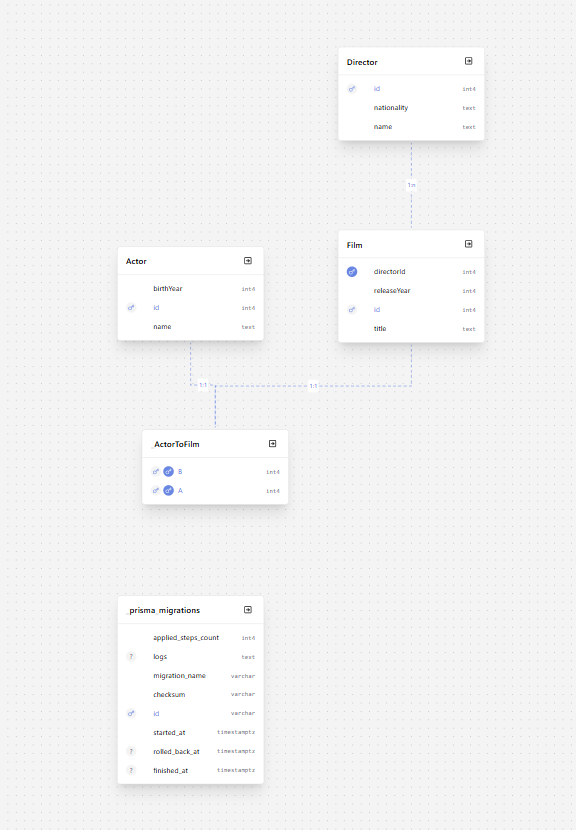

# Relationships

## How to fill this in

1. Save your ERD screenshot as `docs/erd.png`. It will appear under **My ERD** below.
2. Count the relationship lines in your ERD. You need **one section for each line**.
3. In each section, answer the four questions.

---

## My ERD

---

## Relationship #: [Film] and [Actor]
**1. Which tables are linked, and what type of relationship is it?**
**2. What is the cardinality in plain English?**
It is a many to many relationship, as actors can have many films, films can have many actors.  

**3. How is it built in the database?**
in the Film model -
  actor       Actor[]

in the Actor model - 
 film      Film[]

**4. Why did I build it this way?**
Built it this way as it doesn't need a foreign key as its a many to many relationship. 

1. **Which tables are linked, and what type of relationship is it?**
Film to director is a one to many relationship
2. **What is the cardinality in plain English?**
Directors can have many films, but films cannot have many directors. 
3. **How is it built in the database?**
it is built with a foreign key
film model - 
  directorId  Int
  director    Director @relation(fields: [directorId], references: [id])

firector model - 
 film        Film[]

4. **Why did I build it this way?**
As it needs a foreign key to link. 